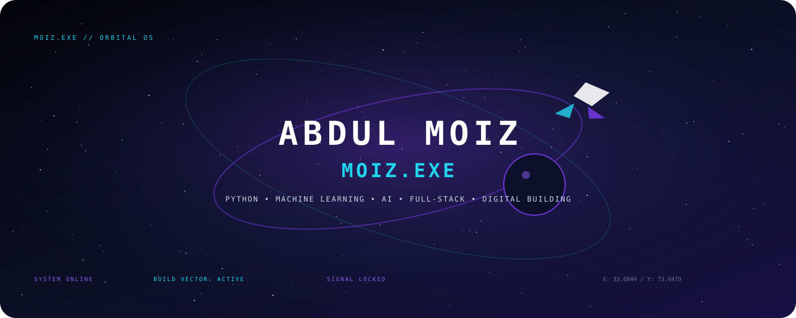
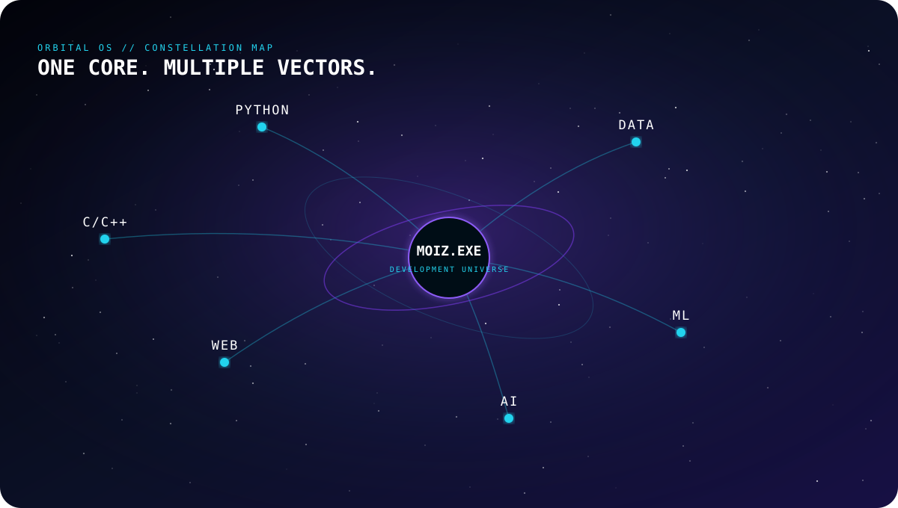
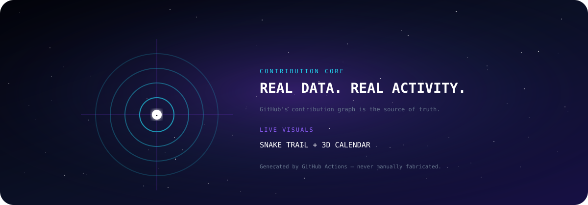

<!--
MOIZ-EXE × AMK
Cinematic developer profile
-->

<p align="center">
  
</p>

<h1 align="center">MOIZ-EXE</h1>

<p align="center">
  <strong>CODE THE UNKNOWN. BUILD WHAT'S NEXT.</strong>
</p>

<p align="center">
  <a href="https://readme-typing-svg.demolab.com/demo/">
    
  </a>
</p>

<p align="center">
  <a href="https://github.com/moiz-exe">
    
  </a>
  <a href="https://www.linkedin.com/in/abdulmoiz495/">
    
  </a>
  <a href="https://github.com/moiz-exe?tab=repositories">
    
  </a>
</p>

<p align="center">
  
</p>

## `01` / The Developer

I'm a computer science student exploring how code, intelligent systems, and security come together to solve real-world problems.

I believe in learning the fundamentals, experimenting with ideas, and turning knowledge into practical projects.

- **Building with:** Python, C, and programming fundamentals
- **Exploring:** Artificial intelligence and machine learning
- **Studying:** Cybersecurity and secure computing
- **Strengthening:** Data structures, algorithms, and problem-solving
- **Vision:** Grow through projects, open source, and continuous learning

> I don't just want to use technology. I want to understand how it works and build something meaningful with it.

## `02` / Selected Missions

<p align="center">
  <a href="https://github.com/moiz-exe/Machine-Learning">
    
  </a>
  <a href="https://github.com/moiz-exe/Python-x-MOIZ">
    
  </a>
  <a href="https://github.com/moiz-exe/c-programs">
    
  </a>
</p>

| Project | Mission |
|---|---|
| [Machine Learning](https://github.com/moiz-exe/Machine-Learning) | Explore machine learning through code and experiments. |
| [Python × MOIZ](https://github.com/moiz-exe/Python-x-MOIZ) | Practise Python and build programming foundations. |
| [C Programs](https://github.com/moiz-exe/c-programs) | Strengthen core programming concepts with C. |
| [Physics HSSC](https://github.com/moiz-exe/Physics-HSSC) | Build educational resources and learning tools. |
| [PBA](https://github.com/moiz-exe/PBA) | Explore another project in my development portfolio. |

<p align="center">
  <a href="https://github.com/moiz-exe?tab=repositories">
    <strong>EXPLORE ALL REPOSITORIES →</strong>
  </a>
</p>

## `03` / Technology Orbit

<p align="center">
  
</p>

<p align="center">
  <code>LOGIC</code> &nbsp;→&nbsp; <code>CODE</code> &nbsp;→&nbsp; <code>EXPERIMENT</code> &nbsp;→&nbsp; <code>IMPROVE</code>
</p>

My priority is not collecting technologies. It's building a strong foundation and learning to use each tool effectively.

## `04` / The Learning Trajectory

<p align="center">
  
</p>

```text
                 THE MISSION
                     │
          ┌──────────┴──────────┐
          ▼                     ▼
    PROGRAMMING             COMPUTER SCIENCE
    Python · C              Data Structures
          │                 Algorithms
          └──────────┬──────────┘
                     ▼
              INTELLIGENT SYSTEMS
              Machine Learning
              Artificial Intelligence
                     │
                     ▼
                CYBERSECURITY
                Secure Computing
                Defensive Security
                     │
                     ▼
              PRACTICAL PROJECTS
              Build · Test · Improve
```

**North star:** turn fundamentals into working projects, and working projects into useful solutions.

## `05` / GitHub Telemetry

<p align="center">
  
  
</p>

<p align="center">
  
</p>

<p align="center">
  <sub>Statistics depend on external services and their availability.</sub>
</p>

## `06` / Contribution Core

<p align="center">
  
</p>

<p align="center">
  
</p>

<p align="center">
  <sub>The contribution animation requires a working GitHub Actions workflow and generated SVG files in the output branch.</sub>
</p>

## `07` / Beyond the Code

**AMK** represents the broader vision: learning, creating, and developing ideas into real projects.

The current focus is building strong technical foundations, sharing useful work, and growing one project at a time.

<p align="center">
  
</p>

<p align="center">
  <strong>LEARN DEEPLY. BUILD BOLDLY. STAY CURIOUS.</strong>
</p>

<p align="center">
  <a href="https://github.com/moiz-exe">GITHUB</a>
  &nbsp;·&nbsp;
  <a href="https://www.linkedin.com/in/abdulmoiz495/">LINKEDIN</a>
  &nbsp;·&nbsp;
  <a href="https://github.com/moiz-exe?tab=repositories">PROJECTS</a>
</p>

<p align="center">
  <sub>MOIZ-EXE × AMK · Every commit is another step into the unknown.</sub>
</p>
