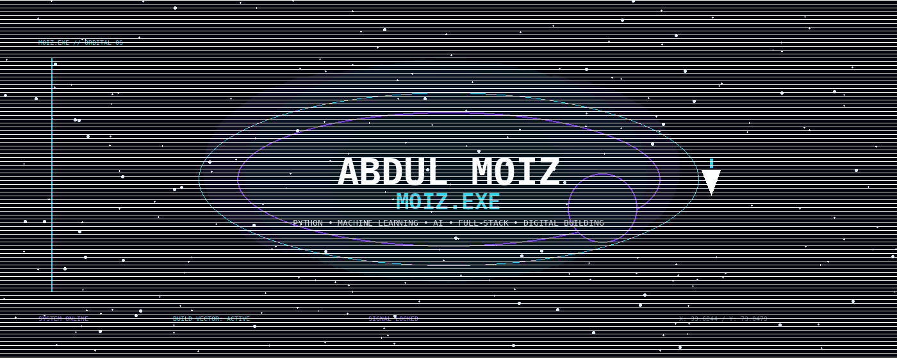

<!-- =========================================================
     MOIZ-EXE | PROFILE README
     Keep the identity honest, the projects real, and the code clean.
========================================================== -->

 

# AMK · MOIZ-EXE

### Computer Science Student · Developer in Progress

**Python · C/C++ · Data Structures · Machine Learning · AI · Cybersecurity**

*Learn deeply. Build consistently. Improve continuously.*

---

## `01` — About

I'm Abdul Moiz, a computer science student building practical skills through programming, experimentation, and personal projects.

My current direction is **Python → Data Structures → Machine Learning → AI**, while exploring cybersecurity and software development.

I believe progress comes from understanding the fundamentals, solving real problems, and improving projects through iteration.

- **Currently learning:** Python, data structures, and machine learning fundamentals
- **Exploring:** Artificial intelligence, cybersecurity, and software engineering
- **Building:** Educational tools, programming projects, and practical experiments
- **Approach:** Learn the concept → implement it → test it → improve it

> This profile is a record of my learning journey, projects, and progress—not a claim of mastery.

## `02` — Technology stack

**Core focus:** Programming fundamentals, problem-solving, data structures, and project-based learning.

*Icons represent technologies I use or am learning; proficiency varies.*

## `03` — Selected projects

Projects are the center of this profile. Explore the repositories to see the code, implementation, and progress.

<table>
  <tr>
    <td width="50%" valign="top">

### Physics HSSC

An educational resource project for HSSC Physics.

[**Open repository →**](https://github.com/moiz-exe/Physics-HSSC)

[Open project website →](https://moiz-exe.github.io/Physics-HSSC/)

    </td>
    <td width="50%" valign="top">

### Physics PBA

A project focused on physics practical-based learning resources.

[**Open repository →**](https://github.com/moiz-exe/PBA)

[Open project website →](https://moiz-exe.github.io/PBA/)

    </td>
  </tr>
  <tr>
    <td width="50%" valign="top">

### Machine Learning

A repository for learning and experimenting with machine learning.

[**Explore the code →**](https://github.com/moiz-exe/Machine-Learning)

    </td>
    <td width="50%" valign="top">

### Python × MOIZ

Python programming practice and development.

[**Explore the code →**](https://github.com/moiz-exe/Python-x-MOIZ)

    </td>
  </tr>
</table>

**More code:** [C Programs](https://github.com/moiz-exe/c-programs)

## `04` — Current learning roadmap

`Python` → `Data Structures` → `Machine Learning` → `AI`

Alongside this path, I'm developing better software habits:

- Write readable, maintainable code.
- Test edge cases instead of relying on one successful run.
- Use Git and GitHub to track changes.
- Document project goals, setup, and limitations.
- Build projects that demonstrate actual understanding.

## `05` — GitHub activity

 

*Statistics are generated by third-party services and may be delayed or incomplete.*

## `06` — Contribution graph

<picture>
  <source media="(prefers-color-scheme: dark)" srcset="https://raw.githubusercontent.com/moiz-exe/moiz-exe/output/github-snake-dark.svg" />
  <source media="(prefers-color-scheme: light)" srcset="https://raw.githubusercontent.com/moiz-exe/moiz-exe/output/github-snake.svg" />
  
</picture>

## `07` — Connect

Interested in programming, AI, cybersecurity, and learning through real projects.

- **GitHub:** [@moiz-exe](https://github.com/moiz-exe)
- **LinkedIn:** [Abdul Moiz](https://www.linkedin.com/in/abdulmoiz495/)

---

**EXPLORE · BUILD · IMPROVE**

*One project at a time.*

**AMK** · `moiz-exe`

